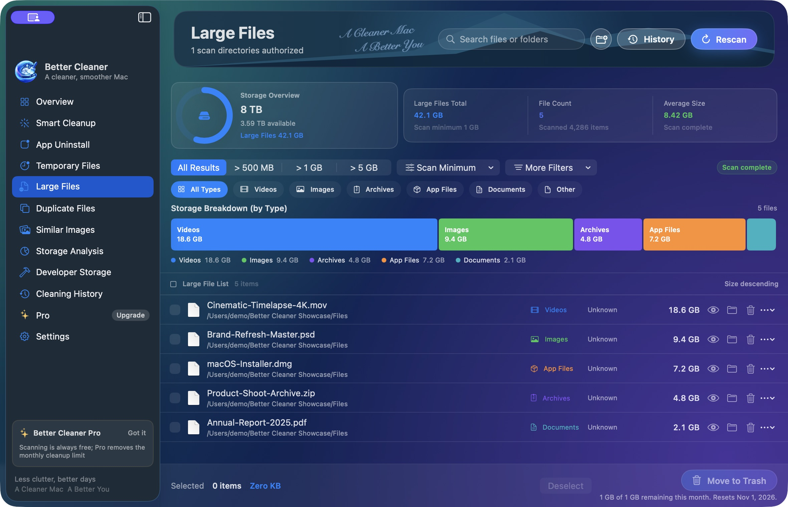
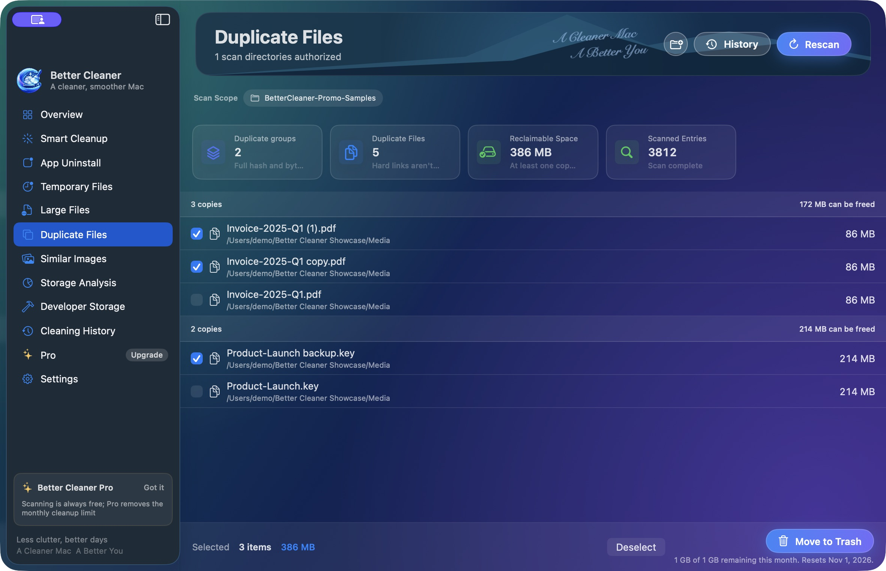
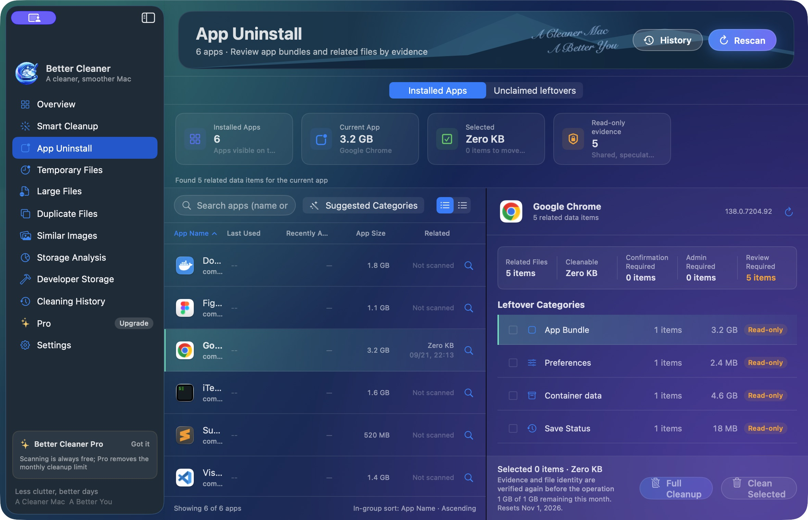

# Better Cleaner

[简体中文](README.zh-CN.md)

A native macOS space management tool that helps you see what takes space, review what can go, and keep every cleanup within your control.

Better Cleaner scans the folders you authorize, then helps you review large files, temporary files, duplicate files, similar images, storage distribution, apps and related files. Scanning and analysis stay on your Mac. Cleanup moves confirmed items to the macOS Trash instead of erasing them automatically.

## Download

<b>Free to download</b> · scan and review without an account  
macOS 14 or later  
Using <a href="https://github.com/mas-cli/mas">mas</a>? <code>mas install 6805775995</code>

## When to use Better Cleaner

- Find large files by size and type before deciding what to move to Trash.
- Review rebuildable temporary files and logs instead of treating every cache as disposable.
- Compare verified duplicate groups while keeping at least one copy in each group.
- Compare similar images yourself and explicitly choose the original to keep.
- Inspect storage by directory and file type within the scope you authorize.
- Review an app bundle and related files by evidence, including shared and protected items.
- Keep local receipts, failure reasons, and recovery entry points after cleanup.

## Highlights

- **Authorized folders** — Better Cleaner scans only the folders you select through the macOS system picker. You can remove access in Settings.
- **Review before cleanup** — Every cleanup needs your confirmation. Duplicate files and similar images start with nothing selected; similar images require an explicit keeper.
- **Large and temporary files** — Sort, filter, inspect, and decide what belongs in the Trash.
- **Verified duplicates** — SHA-256 matching is followed by direct byte comparison, and each duplicate group keeps at least one copy.
- **Storage Analysis** — Explore directory trees, bubbles, rings, and file-type distribution for the scanned scope.
- **App Uninstall** — Review app bundles, associated files, shared items, and protected boundaries by evidence. Complete leftover detection is not guaranteed.
- **Cleaning History** — Read item-by-item receipts, failure reasons, and available restore actions on this Mac.
- **Developer Storage** — Review rebuildable project artifacts and tool caches inside authorized folders.

## Screenshots

**Large Files** — Sort by size, filter by type, and review each item before moving it to Trash.

| | |
|---|---|
|  |  |
| **Duplicate Files** — Review verified groups while keeping at least one copy. | **App Uninstall** — Review app-related files without assuming every item is removable. |

The screenshots use sample data from a development build to show the product flow. Values and interface details may change between releases; they are not a promise of cleaning results on a particular Mac.

## Free and Pro

Scanning, results, and Storage Analysis are free and unlimited.

- **Free** — Up to 1,000,000,000 bytes of cleanup in each local calendar month for the current Mac user. All cleanup features share this allowance, which can be used across multiple cleanups; it is not 1 GB per cleanup.
- **Pro** — An auto-renewable App Store subscription available monthly or yearly. Pro removes the monthly cleanup-byte allowance, but does not expand folder access, bypass macOS protection, or start a cleanup automatically.
- When a batch exceeds the remaining allowance, Better Cleaner does not silently clean only part of it.
- Moving items to Trash counts toward the allowance. Disk space is generally reclaimed only after the Trash is emptied.

## Privacy and safety

Better Cleaner processes routine scans, comparisons, and cleanup locally. File contents, filenames, paths, and security-scoped bookmarks do not leave your Mac during ordinary scanning or cleanup. Optional support requests send only what you choose to submit, with attachments previewed and consented to separately.

Better Cleaner does not scan your entire disk by default, delete files automatically, permanently erase files, or guarantee that every item moved to Trash can be restored. It does not bypass macOS permissions or promise complete app-leftover coverage.

## Links

- [Mac App Store](https://apps.apple.com/us/app/better-cleaner/id6805775995?mt=12)
- [Product page](https://bettermac.net/en/products/better-cleaner/)
- [Support](https://bettermac.net/en/support/better-cleaner/)
- [Privacy Policy](https://bettermac.net/en/privacy/)
- [Terms of Use](https://bettermac.net/en/terms/)
- [Contact](mailto:support@bettermac.net)
- [BetterMac website](https://bettermac.net/)

## Requirements

- macOS 14.0 or later
- Interface languages: English, Simplified Chinese, Traditional Chinese, Japanese, and Korean

## License

Better Cleaner and the materials in this repository are proprietary software and are not open source. All rights reserved. No license is granted to copy, modify, distribute, or use them without prior written permission from BetterMacNet.
