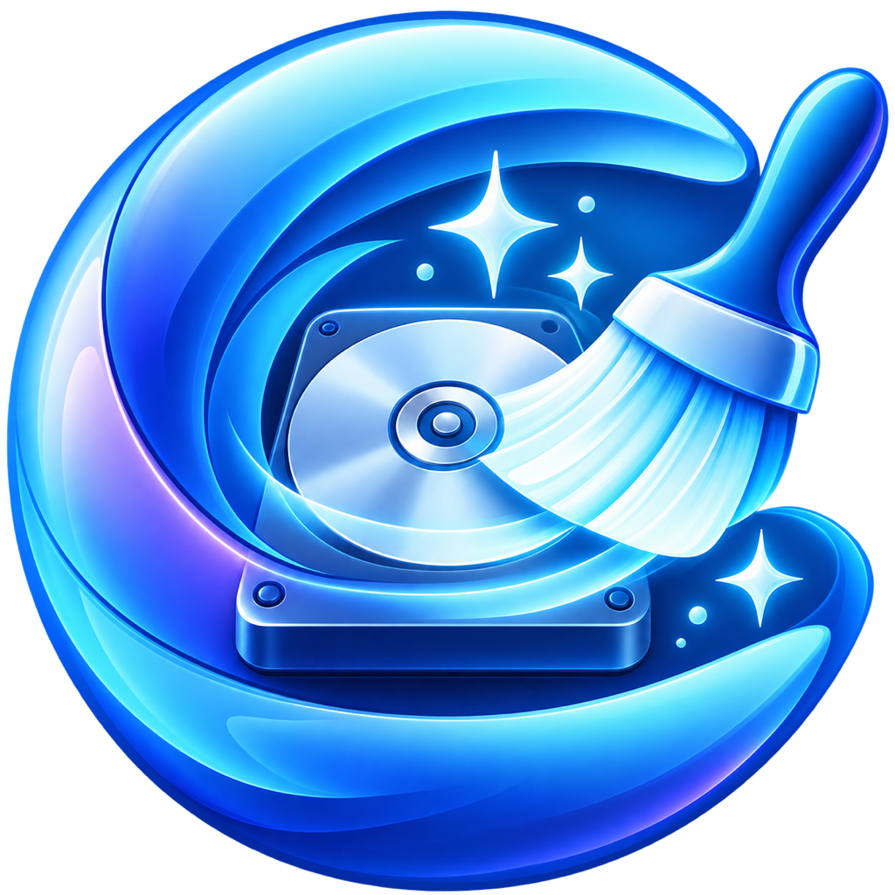
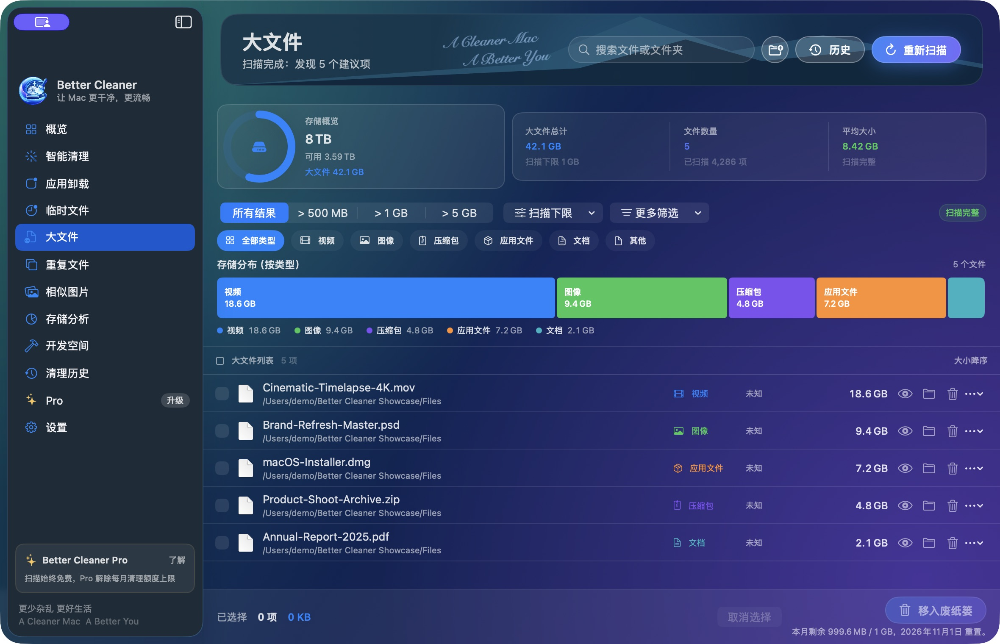
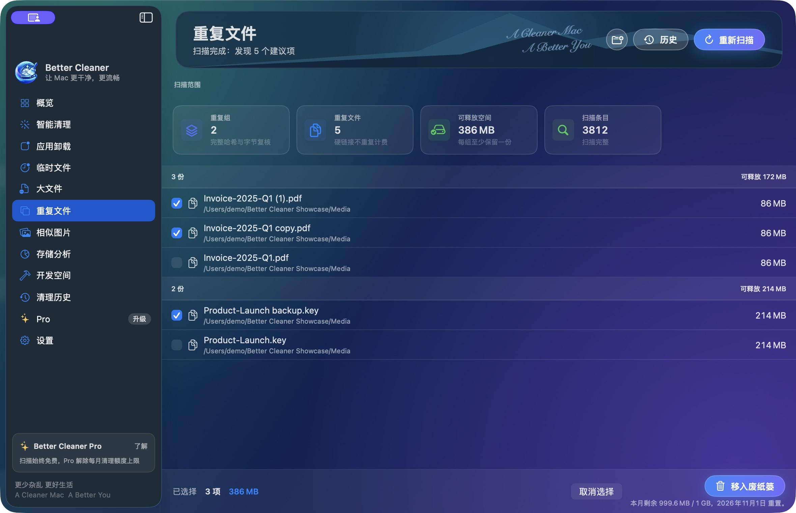
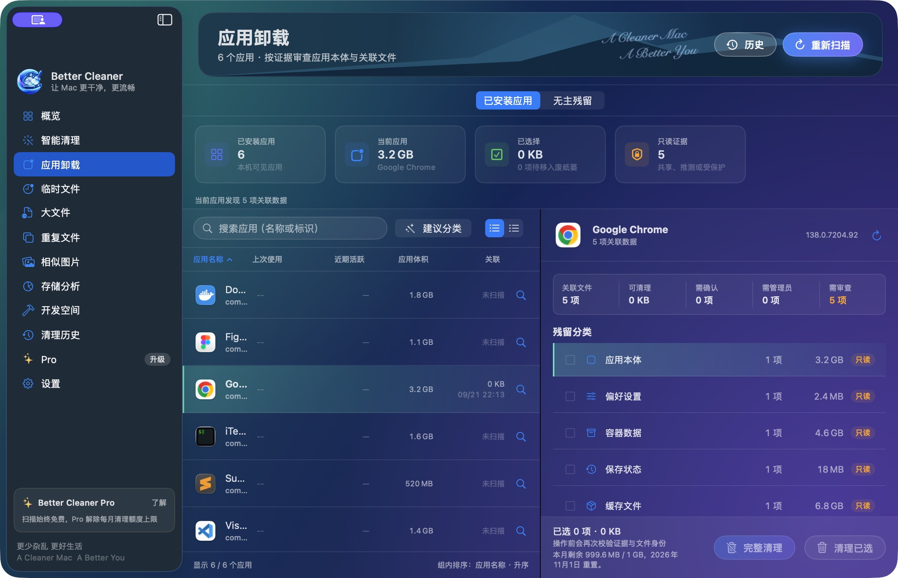

# Better Cleaner

[English](README.md)

一款原生 macOS 空间管理工具：看清占用、审查候选、从容决定什么可以清理。

Better Cleaner 只扫描你明确授权的文件夹，帮助你查看大文件、临时文件、重复文件、相似图片、存储分布、应用及其关联文件。扫描与分析在本机完成；确认后的项目会移入 macOS 废纸篓，而不是自动永久删除。

## 下载

<b>免费下载</b> · 无需账号即可扫描与查看  
macOS 14 或更高版本  
使用 <a href="https://github.com/mas-cli/mas">mas</a>？<code>mas install 6805775995</code>

## 什么时候使用 Better Cleaner

- 按体积和类型查找大文件，决定哪些项目适合移入废纸篓。
- 查看可重建的临时文件与日志，不把所有缓存都当作可以直接删除。
- 审查经过验证的重复文件分组，每组至少保留一个副本。
- 并排比较相似图片，由你明确选择要保留的原图。
- 在授权范围内按目录和文件类型查看存储分布。
- 按证据查看应用包及关联文件，区分共享项目与受保护项目。
- 清理后在本机保留逐项回执、失败原因与可用的恢复入口。

## 主要功能

- **授权文件夹** — 只扫描你通过 macOS 系统面板选择的文件夹，可在「设置」中移除访问权限。
- **清理前先审查** — 每次清理都需要你确认；重复文件和相似图片默认不会替你选中，相似图片必须明确指定保留原图。
- **大文件与临时文件** — 排序、筛选、预览后，再决定哪些项目移入废纸篓。
- **重复文件验证** — 先用 SHA-256 匹配，再逐字节复核；每组至少保留一个副本。
- **存储分析** — 在授权范围内查看目录树、气泡图、环形图与文件类型分布。
- **应用卸载** — 按证据审查应用包、关联文件、共享项目和受保护边界；不承诺覆盖所有残留。
- **清理历史** — 在本机查看逐项回执、失败原因与可用的恢复操作。
- **开发空间** — 在授权文件夹内查看可重建的项目产物与工具缓存。

## 截图

**大文件** — 按体积排序、按类型筛选，查看每个项目后再移入废纸篓。

| | |
|---|---|
|  |  |
| **重复文件** — 审查已验证的分组，每组至少留下一份。 | **应用卸载** — 查看应用关联文件，不把所有项目都视为可移除。 |

截图使用开发构建中的样例数据展示产品流程。数值和界面细节可能随版本变化，不代表某台 Mac 的实际清理结果。

## 免费版与 Pro

扫描、查看结果和存储分析永久免费、不限次数。

- **免费版** — 本机当前 macOS 用户每个自然月最多清理 1,000,000,000 字节。所有清理功能共享这份额度，可分多次使用；不是每次清理 1 GB。
- **Pro** — Mac App Store 自动续期订阅，提供月度和年度周期。Pro 只解除每月清理字节额度，不扩大文件夹访问范围、不绕过 macOS 保护，也不会自动开始清理。
- 如果一批项目超过剩余额度，Better Cleaner 不会静默只清理其中一部分。
- 移入废纸篓的项目会计入额度；通常要清空废纸篓后，磁盘空间才会真正释放。

## 隐私与安全

Better Cleaner 的日常扫描、比对和清理均在本机完成。普通扫描或清理期间，文件内容、文件名、路径和安全作用域书签不会离开你的 Mac。可选的支持请求只发送你主动提交的内容；附件会分别预览并征得同意。

Better Cleaner 默认不会扫描整个磁盘，不会自动删除或永久擦除文件，也不保证移入废纸篓的每个项目都能恢复。它不会绕过 macOS 权限，也不承诺覆盖所有应用残留。

## 链接

- [Mac App Store](https://apps.apple.com/app/id6805775995)
- [产品页](https://bettermac.net/products/better-cleaner/)
- [支持中心](https://bettermac.net/support/better-cleaner/)
- [隐私政策](https://bettermac.net/privacy/)
- [服务条款](https://bettermac.net/terms/)
- [联系我们](mailto:support@bettermac.net)
- [BetterMac 官网](https://bettermac.net/)

## 系统要求

- macOS 14.0 或更高版本
- 界面语言：英文、简体中文、繁体中文、日文和韩文

## 许可

Better Cleaner 及本仓库中的材料均为专有软件，并非开源。保留所有权利。未经 BetterMacNet 事先书面许可，不授予复制、修改、分发或使用的任何许可。
